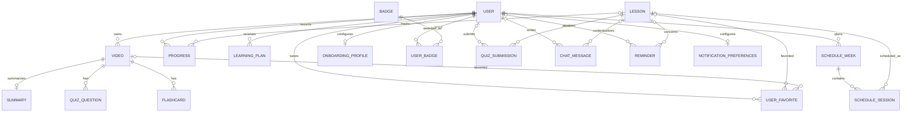
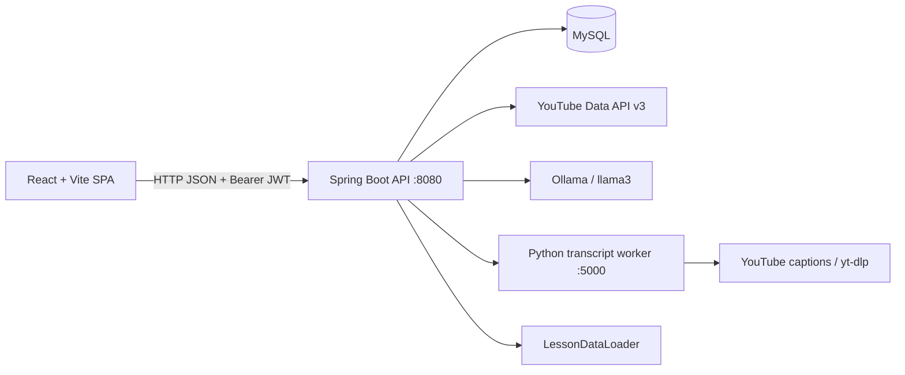

# Lexigrain Project Discovery Report

**Scope and evidence.** This report describes the checked-in implementation in this workspace as inspected on 2026-11-19. Source code is treated as authoritative; `backend/.cursor/rules/lexicon_platform_spec (1).mdc` is an aspirational product/MVP specification, not proof that its proposed architecture or features exist. Findings are static unless a build/test result is explicitly stated. No application source or configuration was changed for this report.

## 1. Executive Summary

Lexigrain is a browser-based learning application whose implemented center of gravity is personalized discovery of YouTube learning videos. A learner enters a topic/preference; the Spring API uses Ollama to normalize it, searches YouTube, asks a separate Python service for captions, uses Ollama again to create summaries, questions, flashcards, and a learning plan, and can persist the resulting materials for the signed-in user. The React app also provides a seeded lesson catalog, onboarding, profile, schedule, progress, favorites, and settings screens.

The codebase is a multi-project repository rather than a deployed microservice platform: a Spring Boot/MySQL API, a React/Vite SPA, and a Python transcript service. The actual AI/content flow is synchronous and external-service-dependent. Several frontend calls have no matching controller or use a different HTTP method/path from the backend, so the presence of a screen or API wrapper does not establish that the feature works end to end.

**Verified status:** the frontend production build succeeds. The only backend test is a Spring application-context test; it fails in this environment because it cannot connect to the configured MySQL server. The transcript service's checked-in Dockerfile and requirements do not match its Python module, so its container is not currently runnable as written.

**Most important risks:** authenticated profile updates can target another account by name; production configuration permits a checked-in JWT secret fallback; the transcript service's deployment artifacts are inconsistent; and multiple profile/chat/quiz/settings frontend contracts do not match backend routes.

## 2. Product Overview & Vision

The product name shown in the UI is **Lexigrain** (the Java application is named `Lexicon`). The implemented problem is helping a learner turn a subject preference into a small, structured collection of learning material and then track study activity. The product value visible in the code is a workflow that combines existing video content with AI-generated study aids rather than requiring users to author course materials.

The MVP/product brief in `backend/.cursor/rules/lexicon_platform_spec (1).mdc` describes micro-learning, AI study aids, personalization, progress, and gamification. It also proposes an API gateway, multiple backend services, embeddings/vector search, cloud storage, and notification scheduling. Those are design aspirations; the runtime inspected here is a Spring monolith plus the Python caption service and a single-page frontend. No evidence was found for a separate API gateway, vector store, recommendation service, S3/Cloudflare storage, or a code execution lab.

The code does not establish a competitor analysis or a specific differentiator beyond personalizing content around the learner's preference and generating study materials. The product's actual long-term intent therefore remains partly uncertain.

## 3. Core Product Philosophy

The implemented flow favors practical, video-based learning enriched with summaries, question/answer pairs, flashcards, and a generated learning plan. The SPA exposes dashboard, library, lesson, schedule, and progress surfaces intended to make learning a continuing habit.

The product brief additionally emphasizes short content, personalized recommendations, spaced repetition, and gamification. These should be treated as future intent unless verified in the implementation. For example, an entity exists for reminders, but no reminder API or reminder delivery job was found; badges are represented in persistence and progress responses, but a complete award workflow was not found.

## 4. Target Users & Value Proposition

The registration domain includes `USER`, `SoftwareDeveloper`, `UIUXDesigner`, `ProductManager`, `FinanceProfessional`, and `Marketing` role values. The front-end signup currently sends `USER`; onboarding stores goals and skills separately. This suggests general learners, especially people pursuing professional skills, but user research and persona requirements are not present in the repository.

The value proposition supported by source is: enter a topic, get candidate videos with transcript-derived study aids, and keep track of the resulting learning activity. The broader role-based learning market and alternatives cannot be determined from code alone.

## 5. Features & Functional Breakdown

| Feature | What the implementation does | Status |
|---|---|---|
| Sign up / sign in | Registers with email/password and returns a JWT on login; passwords are BCrypt-encoded. Signup routes into onboarding and does not automatically sign in. | Implemented, with validation/security gaps noted below |
| Onboarding | Persists goals, skills, study time, schedule preferences, and reminder preference in a user-owned profile; frontend temporarily stores values locally before login. | Partially implemented |
| Topic-based content processing | Normalizes a preference with Ollama, searches YouTube, checks/fetches transcripts, generates study aids and a learning plan, and optionally saves them to the current user's records. | Implemented but operationally fragile and slow |
| Curated lesson library | Seeds six sample lessons when the lesson table is empty; provides list/detail, completion, and favorite operations. | Partially implemented; seed catalog is small and static |
| Video study materials | Lists a user's processed videos, details, questions, flashcards, learning plans, completion, and favorites. Ownership is checked when reading a video by ID. | Implemented |
| Quiz / flashcards | AI-generated questions and cards are attached to processed videos. A second lesson-oriented quiz data model exists, but its API routes are absent. | Partially implemented |
| Chat | Backend exposes a topic-generation endpoint. The SPA chatbot calls `/api/ai/chat`, for which no controller was found. | Broken/incomplete end to end |
| Schedule | Persists week/session records with add, update, replace-week, and delete operations scoped to the current user. | Implemented; UI also uses local/mock sources |
| Progress | Records lesson completion and exposes summary, weekly activity, and time statistics. Some counters are based on schedule sessions and others on progress records. | Partially implemented; measures are inconsistent |
| Favorites | Toggles lesson and user-owned video favorites. The UI has fallback/mock paths. | Implemented |
| Profile/settings | Avatar update has a matching endpoint. Profile-update and notification wrappers do not match a backend route; change-password uses the wrong HTTP method in the frontend. | Partially implemented |
| Search/categories | YouTube search exists; a lesson category endpoint does not. The library's category list falls back to local categories. The layout search input has no visible submission handler. | Partially implemented |
| Badges/reminders/subscriptions | Entities and DTOs exist for some of these concepts, but complete user-facing APIs/workflows were not found. | Planned/partial |
| Marketing pages | Landing and marketing components advertise product capabilities and pricing. They are front-end content, not evidence of billing or those advertised capabilities. | UI implemented; business integration unknown |

## 6. User Journeys

### New learner

1. The learner visits `/home` or the signup page.
2. Signup submits name, email, password, `USER`, and an empty goals list to `POST /api/auth/register`.
3. The UI navigates to onboarding. Before a JWT exists, onboarding data/preference can be retained in browser storage.
4. The user signs in. The sign-in/auth refresh path attempts to persist pending onboarding and, when present, process the pending preference.
5. Processing generates user-specific videos and study aids; the learner then visits dashboard/library/lesson views.

This sequence is visible in `SignUp.tsx`, `Onboarding.tsx`, `SignIn.tsx`, and `AuthProvider` in `auth.tsx`. Exact behavior depends on service availability and local-storage state. There is no route guard in `App.tsx`/`Layout.tsx`; backend authorization is the effective protection for API data.

### Returning learner

The frontend restores a cached user and JWT from `localStorage`, refreshes the current user from `/api/auth/me`, and loads progress, videos, favorites, and schedules through endpoint wrappers. Learners can complete or favorite content and edit schedule sessions. When requests fail, several pages/hooks fall back to mock or local state, so a visible UI state is not necessarily persisted.

### Content-generation flow

`GET /api/process/preference` calls a synchronous processing pipeline. The backend generates a topic, searches YouTube, selects videos with caption availability, fetches transcripts, generates per-video content and a combined learning plan, and saves the results if the request has an authenticated user. `/preference/preview` performs processing without persistence. The request can depend on YouTube API quota, the transcript worker, local/deployed Ollama, and long-running HTTP timeouts.

## 7. Business Logic & Domain Model

- **Identity:** `User` owns an email, password hash, role, goals, profile fields, and activation flag. The database marks `name` unique but does not mark `email` unique, although registration checks for an existing email in application code.
- **Lessons:** `Lesson` is a static catalog item with type, level, category, tags, content/video URLs, duration, and timestamps.
- **Generated videos:** `Video` belongs to one `User` and holds a YouTube video ID, transcript, topic, and relations to summary, quiz questions, and flashcards. Learning plans belong to a user.
- **Progress:** `Progress` belongs to a user and optionally references a lesson, with status, completion time, and percent. The video-completion code attempts to represent video IDs as negative lesson IDs but persists a null lesson relation; the negative ID is therefore not stored in that FK.
- **Schedule:** `ScheduleWeek` is unique by `(user_id, week_id)` and owns sessions. Sessions may refer to a lesson and contain date, planned/actual minutes, status, and focus tag. Updating/replacing a week is a user-scoped workflow.
- **Personalization:** `OnboardingProfile` is one-to-one with a user. Goals/skills/days are serialized JSON strings; onboarding also projects goals to the separate `User.goals` collection.
- **Other persisted concepts:** `UserFavorite` can refer to either a lesson or video; `UserBadge` has a composite user/badge key; `QuizSubmission`, `ChatMessage`, `Reminder`, and `NotificationPreferences` are mapped entities, but several lack corresponding implemented APIs.
- **Progress rules:** summary counts `Progress` records; points are 10 per completed progress record, and level increments every 100 points. Weekly activity/time are derived from `DONE` schedule sessions. The “streak” calculation is based on completed schedule sessions, not the same source as lesson completion counts.
- **Transactions and validation:** service classes use Spring transactions for selected persistence flows. Request DTO validation is applied to auth requests, but most schedule/profile operations accept generic maps or unvalidated DTOs. Schedule week save skips invalid individual sessions rather than rejecting the entire update.

### Entity relationship diagram

The diagram reflects JPA relations, not a separately versioned database schema. Optional edges indicate nullable entity relations; no migration scripts were found.

## 8. Technology Stack

| Area | Technology | Role in this repository |
|---|---|---|
| Backend | Java 21, Spring Boot 3.5.3 | REST API, authentication, business logic, persistence, async task pool |
| Persistence | Spring Data JPA/Hibernate, MySQL 8 | Relational data; schema changes are currently managed via `ddl-auto=update` |
| Security | Spring Security, JJWT 0.12.3, BCrypt | Stateless bearer JWT authentication and password hashing |
| Backend libraries | Lombok, MapStruct, Jackson, Spring Retry/AOP, Bucket4j | Boilerplate reduction/mapping, JSON, retry/AOP, in-memory rate limiting |
| Frontend | React 18, TypeScript 5.8, Vite 5, React Router 6 | SPA, routes, bundling and development server |
| Frontend UI | Tailwind CSS, Radix UI/shadcn-style components, Lucide, Framer Motion/GSAP, Recharts | Styling, accessible primitives, animation, charts |
| Frontend data | TanStack React Query, local API wrapper | Query client and typed endpoint wrappers; several wrappers are stale/mismatched |
| Transcript service | Python 3.11 container intent; Flask/Flask-CORS code, `youtube-transcript-api`, optional `yt-dlp`, `requests` | Caption lookup and transcript caching |
| AI | Ollama HTTP API, model name `llama3` | Topic normalization, summaries, questions, flashcards, and learning plans |
| Video search | YouTube Data API v3 | Search and duration metadata; requires a configured API key |
| Deployment | Railway JSON configurations and Dockerfiles | Backend/frontend launch definitions; transcript worker configuration is inconsistent |
| Tests | JUnit 5/Spring Boot Test; frontend has build/lint scripts | Current Java test is a context-load test; no comprehensive functional test suite found |

Exact resolved dependency versions are governed by Maven and the npm lockfile; no lockfile is present for Maven dependencies.

## 9. System Architecture

The actual system is a layered Spring application, not the microservice/API-gateway diagram in the product spec. The frontend calls the API directly; the API uses MySQL and makes outbound requests to YouTube, Ollama, and the transcript service.

Most AI processing is a synchronous request/response path. The backend creates a fixed-size executor for video work, but a single semaphore also serializes calls into the processing critical section. No durable queue or independent AI service exists in the implementation. The API has long configured timeouts to accommodate this work.

## 10. Backend Architecture

- `LexiconApplication` starts Spring Boot and enables retry and scheduling.
- `controller/` contains REST controllers; `service/` plus `service/impl/` holds workflows; `repository/` defines Spring Data JPA repositories; `domain/entity/`, `domain/dto/`, and `domain/` contain persistence models, payloads, and enums.
- `SecurityConfig` wires stateless Spring Security, CORS, role matchers, and the JWT filter. `JwtAuthFilter` reads bearer tokens and loads authorities through `UserDetailsServiceImpl`.
- `GlobalExceptionHandler` maps selected validation/runtime exceptions. Controllers also catch exceptions individually and commonly return maps with `status`/`message`.
- `LessonDataLoader` seeds six example lessons only when the lesson table is empty.
- `ProcessServiceImpl` orchestrates topic generation, search, transcript acquisition, AI content generation, and persistence through `StudyMaterialServiceImpl`.
- `StudyMaterialServiceImpl` creates user-owned videos and related materials; video reads check ownership against the current user.
- `ProgressServiceImpl` combines progress records with schedule records for analytics.
- `RateLimitAspect` applies local in-memory limits to signup/login and periodically removes idle buckets.

Typical request: the API security filter validates a JWT, controller resolves the user from the JWT principal, service applies business logic and repository queries/saves, then the controller returns a JSON DTO or an ad-hoc map. Error response formats are not uniform.

## 11. Frontend Architecture

`App.tsx` declares public marketing/auth/onboarding/processing routes and app pages under a shared `Layout`. `AuthProvider` caches user data and refreshes it from `/api/auth/me`. `lib/api.ts` selects a configured API base, attaches a bearer token, and exposes typed convenience wrappers. Page and feature components are grouped under `pages/`, `components/`, `hooks/`, and `lib/`.

The SPA uses local storage for auth token, cached user, onboarding/pending preference, theme, and some client-side state. `useSchedule`, `useServerFirst`, `mockData.ts`, and page-level catch/fallback logic allow UI content to render without a successful API call. This is useful for continuity but can mask an unavailable or unimplemented backend feature.

No guarded-route component is wired in `App.tsx`; “protected routes” are a comment, not an auth gate. Backend APIs do enforce JWT authentication for most routes. Several reusable UI components and screens are present, but not every visible interaction is connected to an implemented API (e.g. layout search).

## 12. Database Schema & ER Diagram

The database is MySQL, with JPA entities creating/updating schema at application start through `spring.jpa.hibernate.ddl-auto=update`. No Flyway/Liquibase migrations or checked-in SQL schema were found. Entity fields and relationships are defined in `backend/src/main/java/com/project/Lexicon/domain/entity/`.

Key tables/entities:

| Entity | Important data/relations |
|---|---|
| `User` | Identity, email, password hash, role, profile, goals collection, active flag |
| `Lesson` | Catalog metadata, content/video URL, type/level/category/tags |
| `Progress` | User, nullable lesson, status, completion instant, percent |
| `Video` | User-owned YouTube video metadata, transcript, topic |
| `Summary`, `QuizQuestion`, `Flashcard` | Generated study material related to `Video` |
| `LearningPlan` | User, topic, original preference, plan text |
| `ScheduleWeek`, `ScheduleSession` | User/week unique key and scheduled lesson sessions |
| `OnboardingProfile` | One-to-one user preferences; JSON-like fields stored as text |
| `UserFavorite` | User plus nullable lesson/video target; two uniqueness constraints |
| `Badge`, `UserBadge` | Badge catalog and composite user/badge association |
| `QuizSubmission`, `ChatMessage`, `Reminder`, `NotificationPreferences` | Persistence models without a complete corresponding API workflow found |
| `LessonFavorite` | Separate lesson-only favorite model; current lesson controller uses `UserFavorite` |

Risks: runtime schema mutation complicates controlled production upgrades; email uniqueness is application-only while the database uniquely constrains name; favorite data has two parallel models; and progress uses a nullable lesson relation to represent video completion without a durable video reference.

## 13. API Documentation

All paths below are backend mappings unless marked **frontend-only wrapper**. Requests/responses for many endpoints are ad-hoc maps; consult the named controller/service for the exact current shape. Authentication defaults to required except the `/api/auth/**` and `/api/diagnostic/**` matcher groups. `/api/auth/me` checks for an authenticated principal in the controller; password change resolves the current principal in the service. In practice, clients should send `Authorization: Bearer <JWT>` for all user data routes.

| Method and path | Purpose / payload | Auth |
|---|---|---|
| `POST /api/auth/register` | `{name,email,password,role?,goals?}`; creates account | Public, rate-limited |
| `POST /api/auth/login` | `{email,password}`; returns JWT and user fields | Public, rate-limited |
| `GET /api/auth/me` | Current user | JWT required in effect |
| `PUT /api/auth/change-password` | `{currentPassword,newPassword}` | JWT required in effect |
| `PATCH /api/users/{name}` | Updates profile fields for the path-selected user | JWT required; no ownership check found |
| `PATCH /api/users/me/avatar` | `{avatarUrl}`; updates current user's avatar | JWT required |
| `GET, PUT /api/onboarding/me` | Reads/saves current user's onboarding profile | JWT |
| `GET /api/lessons` or `/api/lessons/list` | Optional `completed`, `inProgress`, `limit`; returns `{status,count,items}` | JWT |
| `GET /api/lessons/{id}` | Lesson plus current user's progress/favorite state | JWT |
| `POST /api/lessons/{id}/complete` | Optional completion body; records completion | JWT |
| `POST /api/lessons/{id}/favorite` | Toggles favorite | JWT |
| `GET /api/lessons/favorited` | Current user's favorited catalog lessons | JWT |
| `GET /api/study-materials/videos` | Current user's generated videos | JWT |
| `GET /api/study-materials/videos/topic/{topic}` | Current user's videos for topic | JWT |
| `GET /api/study-materials/videos/{videoId}` | Owned video and materials | JWT |
| `POST /api/study-materials/videos/{videoId}/complete` | Marks video as completed | JWT |
| `POST /api/study-materials/videos/{videoId}/favorite` | Toggles video favorite | JWT |
| `GET /api/study-materials/learning-plans` | Current user's generated plans | JWT |
| `GET /api/study-materials/videos/{videoId}/questions` | Generated questions for an owned video | JWT |
| `GET /api/study-materials/videos/{videoId}/flashcards` | Generated cards for an owned video | JWT |
| `GET /api/process/preference?preference=...` | Generates materials and saves when an authenticated user is resolved | JWT in security config; **GET has side effects** |
| `GET /api/process/preference/preview?preference=...` | Generates preview without persistence | JWT in security config |
| `GET /api/progress/summary` | Completion/level/points/badges summary | JWT |
| `GET /api/progress/activity/weekly` | Last seven days' schedule activity | JWT |
| `GET /api/progress/time-stats` | Total/week/month/average schedule time | JWT |
| `POST /api/progress/migrate-local` | Migrates local completion map | JWT |
| `GET /api/dashboard/recent-activity?days=&limit=` | Merges completion and schedule activity | JWT |
| `GET /api/schedule/weeks/{weekId}` | Returns week and sessions | JWT |
| `PUT /api/schedule/weeks/{weekId}` | Replaces/saves week session set | JWT |
| `POST /api/schedule/weeks/{weekId}/sessions` | Adds a session | JWT |
| `PATCH /api/schedule/weeks/{weekId}/sessions/{sessionId}` | Patches owned session | JWT |
| `DELETE /api/schedule/weeks/{weekId}/sessions/{sessionId}` | Deletes owned session | JWT |
| `GET /api/youtube/search?query=` | Search YouTube videos | JWT by default |
| `GET /api/chat/topic?preference=` | Generates a topic string, not a conversational response | JWT by default |
| `POST /api/transcription/from-youtube?url=` | Fetches a transcript through the transcript worker | JWT |
| `GET /api/diagnostic/youtube-test` | Tests YouTube API; returns diagnostic data | Public |
| `GET /api/diagnostic/transcript-test` | Tests hard-coded transcript URLs | Public |
| `GET /api/diagnostic/config-check` | Reports configuration state, including an API-key prefix when set | Public |
| `GET /api/diagnostic/full-diagnostic` | Runs the diagnostic checks together | Public |

The transcript worker separately exposes unauthenticated `GET /health`, `GET /check/{video_id}`, `GET /transcript?video_id=...`, and `GET /test` on port 5000. It accepts validated 11-character YouTube IDs and maintains in-memory caches.

**Frontend/backend contract drift verified:** `api.ts` also calls `/api/categories`, `/api/ai/chat`, `/api/me`, `/api/me/notifications`, lesson quiz/flashcard/submission paths, and uses `POST /api/auth/change-password`. No matching backend route was found for these paths; the implemented password route is `PUT`. `endpoints.me.update` uses `PUT /api/me`, while the backend profile route is `PATCH /api/users/{name}`. Treat these UI features as broken or incomplete until exercised against the deployed API.

## 14. Authentication & Security

**Implemented protections:** stateless JWT filter; BCrypt password encoding; bearer token validation; authentication on most API routes; video ownership check; week/session operations looked up through the current user's week; rate limiting for signup/login.

**Concrete concerns:**

1. `application.properties` contains a committed JWT signing value and `application-prod.properties` uses it as the default when `JWT_SECRET` is absent. Any deployment missing its secret can use a predictable shared signing key. Do not copy the value from source into documentation; configure a unique strong secret outside the repository and fail startup when it is absent in production.
2. `UserController.updateUserInfo` accepts a `{name}` target and `UserServiceImpl.editPersonalInfo` updates that record without comparing it to the authenticated user. Any authenticated user can attempt to change another user's email, name, bio, or avatar by selecting their name. This is an authorization/IDOR defect.
3. `/api/diagnostic/**` is public. `config-check` returns a prefix of the YouTube API key when configured, and the diagnostic endpoints can trigger outbound requests. Remove/lock down production diagnostics and never return key fragments.
4. `RateLimitAspect` trusts `X-Forwarded-For`/`X-Real-IP` directly and stores buckets only in a process-local map. A client able to supply forwarding headers may influence the key; limits also do not coordinate across replicas.
5. Browser JWTs are stored in `localStorage`, which increases exposure if an XSS issue is introduced. No CSP configuration was found in the repository.
6. CORS allows a broad `https://*.vercel.app` pattern while credentials are enabled. Narrow allowed production origins to known deployed frontends.
7. Server DTO validation checks required fields but does not enforce a password length/complexity policy; the signup page's client-side minimum is not server-side enforcement.
8. Local database and JWT defaults are present in tracked properties/compose configuration. Production credentials must be externalized. Values are intentionally omitted here.

The `Role` enum does not include `ADMIN`, although the security config has admin matchers. It also uses role names that differ from several allowed authority names in the config. The UI currently registers users as `USER`, but the broader role/authority model should be reconciled before relying on role-specific restrictions.

This is a static code review within a project-discovery task, not a penetration test. No live endpoint or deployed environment was assessed.

## 15. External Integrations

- **YouTube Data API v3:** search and video duration lookup; depends on `youtube.api.key` and quota.
- **YouTube captions:** transcript service tries `yt-dlp` subtitle tracks and then `youtube-transcript-api`; cache is in memory.
- **Ollama:** backend posts prompts to the configured Ollama `/api/chat` endpoint using model `llama3`. This is a local/self-hosted dependency rather than an OpenAI API integration.
- **MySQL:** stores accounts, lessons, generated materials, progress, and schedule records.
- No payment provider, email/push sender, cloud object store, Redis, or vector database integration was found in active source.

## 16. Development Environment & Setup

### Backend

- Requires Java 21, Maven (wrapper is included), and a MySQL database.
- Configure datasource, `JWT_SECRET`, `OLLAMA_API_URL`, `TRANSCRIPT_SERVICE_URL`, and `youtube.api.key` through environment/profile configuration; never rely on the committed JWT fallback outside local development.
- `backend/docker-compose.yaml` starts MySQL, Adminer, and Ollama only; it does not start the Spring API or transcript service.
- `backend/railway.json` builds with Maven and launches the production Spring profile.

### Frontend

- Requires Node 20 as used by the Dockerfile; install from `frontend-2/lexicon/package-lock.json`.
- Run `npm run dev`, `npm run build`, or `npm run lint` from `frontend-2/lexicon`.
- `VITE_API_BASE` controls the API URL; otherwise hosted builds default to same-origin `/api`, and localhost uses `http://localhost:8080/api`.
- Railway config serves the generated `dist` directory.

### Transcript service

The intended container uses Python 3.11 and port 5000, but its `Dockerfile` runs `python main.py` even though the checked-in module is `transcript_service.py`. Its `requirements.txt` lists FastAPI/Uvicorn but the module imports Flask/Flask-CORS and `requests`. As checked in, the image lacks both the expected entrypoint and declared runtime dependencies. The backend's separate Python requirements file is not used by that container.

### Tests and verification performed

- `npm --prefix frontend-2\\lexicon run build`: **passed** with Vite 5.4.19. Warnings: Browserslist data is stale; the generated JS chunk is about 802 KB and the hero image about 845 KB.
- `backend\\mvnw.cmd -f backend\\pom.xml test`: **failed** because `LexiconApplicationTests.contextLoads` could not connect to the configured MySQL service. The test dependency includes H2, but no test datasource override was found. This result does not establish that the backend fails when correctly configured with MySQL.
- Only one backend test was found (`LexiconApplicationTests.contextLoads`). No comprehensive frontend, API integration, or transcript-service tests were found. `frontend-2/schedule-integration-test.js` exists, but no test runner script for it is declared in the frontend package manifest.

## 17. Current Implementation Status

| Area | Status | Evidence / qualification |
|---|---|---|
| Frontend SPA, navigation, marketing pages | COMPLETED as UI | React route/page set builds successfully; some controls are presentation-only |
| Signup/signin/JWT | PARTIALLY IMPLEMENTED | Backend auth flow exists; profile/role concerns remain |
| Onboarding | PARTIALLY IMPLEMENTED | Stored profile and pending local flow exist; depends on subsequent sign-in and processing |
| YouTube-to-study-material processing | PARTIALLY IMPLEMENTED | Full backend workflow exists but requires multiple external services and long synchronous calls |
| Generated video storage and retrieval | COMPLETED in code path | User-owned video and materials persist and are retrievable |
| Seeded lesson browse/detail | PARTIALLY IMPLEMENTED | Six lessons seeded; no full admin authoring workflow found |
| Video quiz/flashcards | PARTIALLY IMPLEMENTED | Read endpoints exist for generated video study aids; answer submission workflow is absent |
| Chat Q&A | BROKEN / QUESTIONABLE | Frontend calls `/api/ai/chat`; backend only exposes `/api/chat/topic` |
| Schedule CRUD | COMPLETED in API | UI/server fallback and parsing behavior still need integrated coverage |
| Progress analytics | PARTIALLY IMPLEMENTED | API exists, but progress/session sources differ; video completion persistence is questionable |
| Favorites | COMPLETED in API | Lesson and video favorites are supported; two favorite entity models coexist |
| Profile edits and notifications | BROKEN / QUESTIONABLE | Frontend wrappers mismatch backend profile route; no notification controller found |
| Transcript service deployment | BROKEN / QUESTIONABLE | Entrypoint/dependency mismatch in Docker artifacts |
| Production backend test | UNKNOWN in configured environment | Only test blocked by unavailable MySQL; frontend build is verified |
| Recommendations, collaborative filtering, gap analysis | NOT IMPLEMENTED in active source | Present in product brief only |
| Vector search, S3 upload, interactive IDE, email/push reminders, billing | NOT IMPLEMENTED / UNKNOWN | No active implementation found |

The most recent commit (`dbf1e7a`, message `update`) deleted a number of earlier deployment and implementation markdown guides. Current top-level onboarding/developer documentation is sparse; `backend/HELP.md` is Maven-generated boilerplate.

## 18. Existing Development Conventions

- Java packages follow `controller`, `service`, `service/impl`, `repository`, `domain/entity`, `domain/dto`, `security`, and `config`.
- Spring controllers use `/api/...` prefixes and return `ResponseEntity`, often with maps; there is no single response envelope shared by all endpoints.
- JPA entity names generally use singular class names; selected entities explicitly set table names and constraints.
- Frontend paths are React Router pages; components are divided by page feature and shared UI. The alias `@` maps to `src`.
- React API calls should go through `src/lib/api.ts` and typed `endpoints`; however, direct fetches and stale wrappers also exist.
- Auth token and user cache keys use the `lexigrain:` local-storage prefix; some legacy keys are migrated.
- Existing error handling mixes controller-level catch blocks, global exception advice, page toasts, and silent/local fallbacks. Future changes should preserve user-scoped lookup and DTO mapping while converging on consistent validation and error semantics.
- Backend schema currently depends on Hibernate `update`; no migration convention is established.
- Git history has generic commit messages (`update`, `Commit`); no reliable commit-message convention could be inferred.

## 19. Technical Debt & Identified Issues

**Objectively observed**

- `PATCH /api/users/{name}` lacks ownership enforcement in the service.
- Production profile permits a repository-defined JWT signing fallback.
- Transcript worker's Docker entrypoint and declared packages disagree with its actual module.
- Several frontend endpoint paths/methods have no matching backend mapping.
- `Progress` cannot durably identify completed videos through its nullable `lesson_id`; code passes a negative ID only to a query and saves `lesson = null`.
- `User.email` lacks a database unique constraint; uniqueness is checked only before save.
- `LessonFavorite` and `UserFavorite` overlap, while current lesson and video flows use the latter.
- Hibernate schema auto-update is used without migration files.
- Progress summary and activity use different sources: `Progress` for completion totals vs. `ScheduleSession` for activity/time/streak.
- API processing mutates persistence through GET and runs external/LLM work synchronously.
- `OnboardingServiceImpl` catches malformed goals JSON and silently leaves user goals unchanged.
- Public diagnostics expose a configured API-key prefix and allow external checks.
- Most backend/controller errors are plain runtime messages or inconsistent maps; no OpenAPI contract was found.
- No meaningful automated behavior coverage beyond a single Spring context test.

**Potential product/UI gaps**

- Routes marked “protected” in a comment have no client-side authentication guard.
- Mock/local fallback paths can make incomplete server connectivity appear functional.
- Search input in the common layout has no visible submit/action wiring.
- Product brief describes more capability than the runtime: collaborative/content-based recommendation, reminders, admin tools, code labs, object storage, semantic Q&A, and gamification rules were not found.

## 20. Prioritized Improvement Recommendations

Priorities are based on source evidence and likely user impact; they are recommendations, not an implementation plan.

| Priority | Recommendation | Basis |
|---|---|---|
| P0 | No confirmed P0 issue identified in this static discovery. | No database loss or unauthenticated arbitrary account takeover was demonstrated. |
| P1 | Enforce current-user ownership for profile edits; remove the name-targeted update or authorize it explicitly. | Authenticated callers can target another user's record through `PATCH /api/users/{name}`. |
| P1 | Remove committed JWT fallback and require a unique external secret in production. Rotate any production key that may have used the fallback. | `application-prod.properties` falls back to the checked-in signing value. |
| P1 | Repair transcript service packaging/entrypoint and add a container smoke test. | Dockerfile runs the wrong module and requirements omit imported frameworks. |
| P1 | Reconcile frontend endpoint wrappers with actual controllers, prioritizing chat, password change, profile update, quizzes, and notifications. | Several visible actions currently call routes/methods absent from the backend. |
| P1 | Correct the video-completion model so a completion stores a real video relation or dedicated video progress key. | Current nullable lesson relation loses the pseudo-ID and makes de-duplication/reporting unreliable. |
| P2 | Add database uniqueness for email and use controlled schema migrations. | Application-only duplicate check races; Hibernate update is not a reproducible migration process. |
| P2 | Restrict diagnostics and CORS; stop returning any key prefix. | Public diagnostics plus wildcard hosted-origin pattern and credentialed CORS increase exposure. |
| P2 | Replace caller-controlled forwarding-header rate-limit keys with trusted proxy configuration and shared storage if horizontally scaled. | Current limiter is in-memory and trusts request headers. |
| P2 | Standardize progress definitions and identify whether totals/streaks measure lessons, videos, or scheduled sessions. | Current analytics combine different sources and may disagree. |
| P2 | Move generation to a durable background job and use POST for processing that creates data; expose progress/failure status. | Current external processing is long-running synchronous work behind GET. |
| P2 | Add backend integration tests with an explicit test datasource and contract tests for the SPA/API. | Existing test requires a live MySQL service and does not cover business behavior. |
| P3 | Reduce frontend bundle/image size and refresh Browserslist data. | Current production build warns on an ~802 KB JS chunk and stale compatibility data. |
| P3 | Restore concise setup, service-boundary, API, and deployment documentation. | Current README/setup docs are absent or boilerplate; several previous docs were removed in recent history. |

## 21. Important Files & Their Responsibilities

| Path | Responsibility |
|---|---|
| `backend/pom.xml` | Java version, Spring Boot and backend dependencies |
| `backend/src/main/resources/application.properties` | Local datasource, JWT, integrations, upload, timeouts |
| `backend/src/main/resources/application-prod.properties` | Production environment/profile defaults |
| `backend/src/main/java/com/project/Lexicon/LexiconApplication.java` | Spring application entry point |
| `backend/src/main/java/com/project/Lexicon/config/SecurityConfig.java` | HTTP security, route rules, CORS, password encoder |
| `backend/src/main/java/com/project/Lexicon/security/JwtAuthFilter.java` | JWT request authentication |
| `backend/src/main/java/com/project/Lexicon/service/impl/ProcessServiceImpl.java` | Topic-to-video-to-learning-material workflow |
| `backend/src/main/java/com/project/Lexicon/service/impl/OllamaServiceImpl.java` | Ollama prompts and AI content parsing |
| `backend/src/main/java/com/project/Lexicon/service/impl/YoutubeServiceImpl.java` | YouTube search, filtering, metadata |
| `backend/src/main/java/com/project/Lexicon/service/impl/StudyMaterialServiceImpl.java` | Generated material persistence and ownership checks |
| `backend/src/main/java/com/project/Lexicon/service/impl/ProgressServiceImpl.java` | Completion and schedule-derived analytics |
| `backend/src/main/java/com/project/Lexicon/domain/entity/` | JPA schema/domain definitions |
| `backend/src/main/java/com/project/Lexicon/controller/` | HTTP routes and request/response handling |
| `backend/src/test/java/com/project/Lexicon/LexiconApplicationTests.java` | Sole discovered backend test |
| `backend/docker-compose.yaml` | Local MySQL/Adminer/Ollama services |
| `backend/railway.json`, `backend/Dockerfile` | Backend deployment definitions |
| `backend/.cursor/rules/lexicon_platform_spec (1).mdc` | Product/MVP aspirations; not runtime contract |
| `frontend-2/lexicon/src/App.tsx` | SPA route table and providers |
| `frontend-2/lexicon/src/lib/api.ts` | API base, bearer-token client, frontend endpoint declarations |
| `frontend-2/lexicon/src/lib/auth.tsx` | Auth context and user refresh |
| `frontend-2/lexicon/src/hooks/useSchedule.ts` | Schedule state and persistence/fallback behavior |
| `frontend-2/lexicon/src/lib/mockData.ts` | Local fallback/demo data |
| `frontend-2/lexicon/package.json` | Frontend dependencies and scripts |
| `frontend-2/lexicon/railway.json`, `frontend-2/lexicon/Dockerfile` | Frontend deployment definitions |
| `transcriptService/transcript_service.py` | Flask transcript service implementation |
| `transcriptService/requirements.txt`, `transcriptService/Dockerfile` | Intended worker dependencies/container; inconsistent with implementation |

## 22. Glossary of Project-Specific Terminology

- **Preference:** Learner-entered topic/learning intent used to create a YouTube search topic.
- **Generated video / study material:** A YouTube video associated with the current user plus transcript-derived summary, questions, and flashcards.
- **Learning plan:** AI-generated content based on generated video summaries, persisted per user.
- **Lesson:** A separate seeded/static catalog entity; it is not the same as a generated `Video`.
- **Progress:** Record tracking completion state; current implementation uses it for lessons and attempts to reuse it for videos.
- **Schedule week/session:** A user's week container and scheduled study task, with planned/actual minutes and status.
- **Onboarding profile:** User-specific preferences stored separately from the account's basic goals list.
- **Preview processing:** Runs the preference workflow without saving results.

## 23. Uncertainties & Questions Requiring Clarification

1. Is the primary product model meant to remain YouTube-first, or should the product spec's authored lessons, labs, and uploaded content become the primary source?
2. Which account roles should exist, and which route groups should each role be allowed to use?
3. Should generated video completion be reported as lesson completion, video completion, or both?
4. Are chat, lesson quizzes, notification preferences, and profile editing intended for the current release? Their frontend calls and persistence models do not currently form complete API flows.
5. Is a production Ollama deployment available and intended to serve `llama3`? The checked-in compose file starts Ollama locally but does not provision/pull a model.
6. What are the authoritative production frontend/API/transcript-service origins and trusted proxy behavior?
7. Should onboarding processing be allowed before authentication, or must processing and persistence always require an account?
8. Is the generic marketing/pricing content intended to represent real subscriptions? No payment or subscription workflow was verified.

